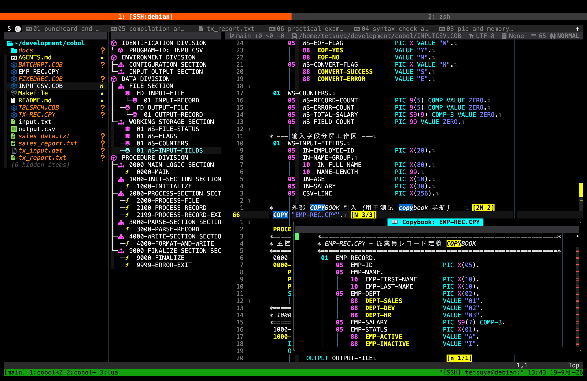

# cobol.nvim

COBOL editing support for Neovim, focused on fixed-format source and practical navigation, editing, structure, and compiler feedback.

The plugin helps you read existing COBOL programs, understand their layout, find definitions and copybooks, inspect data records, and catch syntax errors while you work. It does not require a language server.

[简体中文](README.zh-CN.md) · [日本語](README.ja.md)

The [Chinese README](README.zh-CN.md) covers the same plugin features, settings, and short examples.


The screenshot shows Syms, the optional outline interface configured in this capture, above the
fixed-format column guides and the top Winbar. In the editor, the current `IF ... ELSE ... END-IF`
block is marked by colored opening, branch, and closing badges with a vertical dashed guide line,
and the Winbar shows the structure breadcrumb. Syms is an optional outline UI; the plugin also
ships a COBOL backend for Aerial. Theme colors and layout depend on the user's own Neovim
configuration.

An earlier capture is kept for reference:



It shows the Aerial outline sidebar, fixed-format column guides, 01/88-level highlighting, and the
`K` Copybook preview floating window.

## Who is it for?

`cobol.nvim` is useful for beginners learning fixed-format COBOL, developers maintaining `.cob`, `.cbl`, or `.cobol` programs, and projects that use copybooks and traditional Division/Section/Paragraph structure.

The bundled Aerial backend recognizes COBOL Divisions, Sections, Paragraphs, file descriptions, and level-01 records. Aerial displays these symbols in a searchable Neovim sidebar; without Aerial (or another outline such as Syms), all other navigation features remain available.

## Features

| Area | What it provides | Why it helps |
| --- | --- | --- |
| Fixed-format layout | Guides for columns 7, 8, 12, and 73; overflow highlighting; column jumps | Makes COBOL's source areas visible while you edit |
| Structure and navigation | AST breadcrumbs, nested-block scope badges and guide lines, `%`, `vaf`/`vif`/`vae`/`vie`/`vap`/`vip`, folding, `gd`, `gf`, and `K` | Navigate COBOL control flow by syntax-tree ranges |
| Data layout | PIC and record-size estimates, including `OCCURS` and `REDEFINES` | Gives beginners a practical view of record storage |
| Completion | COBOL keywords, verbs, clauses, snippets, data names, paragraphs, and copybooks | Reduces typing and helps you discover the vocabulary and structure of a program |
| Context information | Format, source area, breadcrumb, current PIC, and record size | Keeps the most useful COBOL context visible while you move through a file |
| Diagnostics | Asynchronous `cobc -fsyntax-only` checks and Quickfix integration | Finds syntax errors without blocking the editor |
| Editing helpers | Comment toggle, smart Tab, reserved-word case formatting | Reduces repetitive work in fixed-format source |
| Optional outline | An outline plugin such as Aerial or Syms; the plugin ships the COBOL backend for Aerial | Provides a searchable tree of the program |

## Requirements

- Neovim 0.10 or newer.
- A C compiler (`gcc`, `clang`, or `cc`) is required to **build** the bundled Tree-sitter parser. The plugin tries to compile a missing parser on startup; AST features (scope badges, breadcrumbs, `%` matching, and text objects) require a usable parser, but no compiler is needed at runtime if `cobol.so` is already installed.
- [blink.cmp](https://github.com/saghen/blink.cmp) is optional. Install it to enable the built-in COBOL completion source.
- GnuCOBOL (`cobc`) is optional. Install it to use compiler diagnostics.
- Aerial is optional. It is a Neovim code-structure/Outline sidebar plugin; install it only if you want the outline view.

## Installation

With [lazy.nvim](https://github.com/folke/lazy.nvim):

```lua
{
  "iamcheyan/cobol.nvim",
  -- Optional: pre-build the Tree-sitter parser during installation.
  build = "bash scripts/build_parser.sh",
  ft = { "cobol", "cbl", "cob" },
  opts = {},
}
```

The repository name belongs in the local lazy.nvim spec, alongside these options. Even without the
`build` hook, the plugin tries to compile a missing parser on startup with the system C compiler. If
no compiler is available, run `./scripts/build_parser.sh` manually once one is installed.

To add the optional Aerial code-structure sidebar, install Aerial and enable the COBOL backend:

```lua
{
  "stevearc/aerial.nvim",
  opts = function(_, opts)
    opts.backends = vim.tbl_deep_extend("force", opts.backends or {}, {
      cobol = { "cobol" },
    })
  end,
}
```

The plugin does not define a default outline keymap. If you want one, set it yourself, for example:

```lua
vim.keymap.set("n", "<leader>cs", "<cmd>AerialToggle<CR>", { desc = "Toggle outline" })
```

Syms and other outline plugins are configured in their own way; use their own toggle commands.

## Configuration

The defaults are suitable for a small project. A project-specific setup can look like this:

```lua
{
  "iamcheyan/cobol.nvim",
  ft = { "cobol", "cbl", "cob" },
  opts = {
    project_root = vim.fn.expand("~/src/my-cobol-project"),
    copybook_paths = { ".", "./cpy", "./copybooks", "./include" },
    cobc_command = "cobc",
    cobc_extra_args = {},
    source_format = "auto",
    structure_scope = { enable = true, char = "┆", show_branches = true },
    folding = { enable = true, foldtext = "auto" },
    diagnostics = { enable = true, debounce_ms = 600 },
  },
}
```

`project_root` and `copybook_paths` are used by copybook navigation and diagnostics. `source_format` accepts `auto`, `fixed`, or `free`. Without a project root, the plugin uses the current file's directory as a fallback.

The default configuration also enables the column guides, Winbar, breadcrumbs, data-level
highlighting, PIC/record size hints, and column-72 overflow highlighting. `columns` defaults to
`{ 7, 8, 12, 73 }`. `structure_scope.enable` turns the paired-structure badges and connecting line
on or off, and `structure_scope.show_branches` controls the `ELSE`/`WHEN` branch badges. Other
options include `smart_tab`, `keymaps`, `show_hierarchy_hint`, `show_pic_size`, `highlight_levels`,
`show_colorcolumn`, `disable_indent_guide`, `folding.foldtext`, `diagnostics.on_save/on_change`,
`diagnostics.warnings/dialect`, and `completion.enable`; see `:help cobol-configuration` for defaults.
The declared `enabled`, `overflow_col`, and `smart_comments` fields do not currently control their
respective behavior; do not use them as switches.

## A first workflow

1. Open a COBOL source file and check the column guides. In fixed-format code, column 7 is the indicator area, columns 8–11 are Area A, columns 12–72 are Area B, and column 73 starts the identification area.
2. Use `gd` on a paragraph or data name. Use `gf` on a `COPY` statement and `K` to preview a paragraph or copybook.
3. To see an outline, install and configure Aerial (or another outline such as Syms). This plugin provides the COBOL symbols/backend but does not bind an outline key by default; Aerial exposes `:AerialToggle`.
4. Place the cursor on a level-01 record or field and press `<leader>cr` to inspect the estimated layout.
5. Save the file or press `<leader>cl` to run a syntax check with GnuCOBOL.
6. Use `za`, `zc`, and `zo` to fold or unfold the current Division, Section, Paragraph, or data item.

For example, save the following as a fixed-format `.cob` file (the leading spaces matter):

```cobol
       IDENTIFICATION DIVISION.
       PROGRAM-ID. DEMO.
       DATA DIVISION.
       WORKING-STORAGE SECTION.
       01 WS-STATUS PIC X VALUE "Y".
       PROCEDURE DIVISION.
           IF WS-STATUS = "Y"
               DISPLAY "READY"
           END-IF.
           STOP RUN.
```

Press `gd` on `WS-STATUS` to visit its declaration and `<C-o>` to return. With the parser available, `%` jumps between `IF` and `END-IF` and the active block gets scope badges. Run `:CobolCalcRecord` on the 01 item and, with `cobc` installed, `:CobolLint` to check the source. On a `COPY "CUSTOMER.CPY".` statement, `gf` opens the Copybook and `K` previews it; add its directory to `copybook_paths` if necessary.

## Fixed-format editing

Toggle the guide with `:CobolGuideToggle`. `:CobolGuideEnable` and `:CobolGuideDisable` reattach
or detach the visual hints and diagnostics (disabling also clears current diagnostics); existing
buffer mappings and folding settings remain in place. The plugin highlights text beyond column 72,
where fixed-format compilers normally ignore source text.

| Key | Destination |
| --- | --- |
| `g7` | Indicator column |
| `g8` | Area A |
| `g12` | Area B |
| `g73` | Identification area |

At the start of a line, Insert-mode `<Tab>` moves input toward Area A or Area B instead of inserting arbitrary indentation. `<leader>c*`, `gcc`, and `:CobolToggleComment` toggle comments according to the detected source format: fixed format uses `*` in column 7, while free format uses `*>`. Visual selections are supported (`gc` in Visual mode, or a range with `:CobolToggleComment`).

In fixed-format buffers, Insert-mode `<Tab>` moves through columns 7, 8, and 12; from column 12 onward it inserts a normal `shiftwidth` indent. `<S-Tab>` reverses through these stops without deleting source text. See the [Chinese feature reference](README.zh-CN.md#固定格式与编辑) for the same behavior.

## Navigation and outline

- `gd` / `:CobolGotoDef`: search the source and recursively referenced Copybooks; choose when names are ambiguous. The current index may miss unindented free-format declarations, so check source format and search paths if a definition cannot be found.
- `gf` / `:CobolGotoCopybook`: open the Copybook under the cursor, with a choice when paths are ambiguous.
- `K` / `:CobolPreview`: preview the declaration and its source file in a floating window.
- `<C-o>`: return through Neovim's jump list.

No outline key is bound by default. When Aerial is installed and configured (see
[Installation](#installation)), use its own toggle such as `:AerialToggle`; an explicit
`<leader>cs` mapping only works if you add it yourself.

### Tree-sitter structural navigation

The plugin automatically compiles and installs the parser on startup if a C compiler (`gcc`, `clang`, or `cc`) is available on your system. You can also specify `build = "bash scripts/build_parser.sh"` in your plugin manager to pre-build it, or build it manually:

```sh
./scripts/build_parser.sh
```

Or compile manually using `gcc`:

```sh
gcc -O2 -shared -fPIC \
  -I tree-sitter-cobol/src -I tree-sitter-cobol/src/tree_sitter \
  -o ~/.local/share/nvim/site/parser/cobol.so \
  tree-sitter-cobol/src/parser.c tree-sitter-cobol/src/scanner.c
```

The automatic build needs a C compiler; without one, the AST features stay disabled until a
`cobol.so` is provided some other way.

With the parser installed:

- **Structure Scope Badges & Connecting Lines**:
  - **Single Active Focus**: Focuses and highlights only the single closest / innermost matching control block at cursor to avoid visual clutter from nested guides.
  - **Closed Control Blocks**: Opening keywords (e.g. `IF`, `EVALUATE`, `PERFORM`, `READ`, `WRITE`, `SEARCH`, `EXEC SQL`, `XML PARSE`, `JSON PARSE`, etc.) and matching `END-*` keywords are highlighted with **distinct colored background badges and crisp bold white text**. A **vertical dashed guide line (`┆`)** is drawn down the aligned column across all inner lines, cleanly enclosing the entire block.
  - **Branches (`ELSE` & `WHEN`)**: Intermediate branches (e.g. `ELSE` in `IF`, `WHEN` in `EVALUATE`) receive matching badge highlights, clearly segmenting branch boundaries like an HTML/XML tag tree.
  - **Customization**: `structure_scope = { enable = true, char = "┆", show_branches = true }`.
- **AST Breadcrumb**: Tracks the full structural hierarchy (`Division > Section > Paragraph > IF > EVALUATE > WHEN`). The vendored grammar keeps statements, headers and `END-*` tokens as flat siblings, so the chain is rebuilt from the paired structure ranges instead of tree ancestry: a `WHEN` clause and its enclosing `IF`/`EVALUATE` are resolved by range, and a division, section or paragraph contributes only its header line. Exposed through:
  - Winbar: Automatically integrated when `show_breadcrumbs = true` in config. The breadcrumb is clipped from the left when the window is narrow, so the innermost structures stay visible.
  - Statusline: `require("cobol.ast").statusline(bufnr)` returns formatted breadcrumb string.
  - Floating Window: `require("cobol.ast").show_breadcrumb_float()` displays the full chain in an interactive floating popup (`q` or `<Esc>` to dismiss). No default keymap is bound.
- **Waiting Closures Stack**: `:CobolStructure` reports the blocks awaiting closure at the cursor position in a Neovim notification, ordered innermost first (e.g. `END-EVALUATE (EVALUATE ...)`, `END-IF`, `END-PERFORM`, `END-EXEC`). Use `require("cobol.ast").show_waiting_closures_float()` for the same list in a floating window. With `show_waiting_closures = true` the stack is also drawn on the right edge of the winbar and follows the cursor. This stack only lists structures the parser was able to pair; a block with a missing `END-*` usually cannot be paired and therefore will not appear, so use `:CobolLint` to find missing terminators.
- **Matching Jump (`%`)**: Press `%` to jump bidirectionally between block starts and their corresponding `END-*` keywords across all supported structures (e.g. `IF` <-> `END-IF`, `EVALUATE` <-> `END-EVALUATE`, `PERFORM` <-> `END-PERFORM`, `EXEC SQL` <-> `END-EXEC`, `XML PARSE` <-> `END-XML`, `JSON PARSE` <-> `END-JSON`, `CLASS-ID` <-> `END CLASS`).
- **Tree-sitter Text Objects**:
  - `vaf` / `vif`: Select around / inside `IF ... END-IF`
  - `vae` / `vie`: Select around / inside `EVALUATE ... END-EVALUATE`
  - `vap` / `vip`: Select around / inside `PERFORM ... END-PERFORM`
- **Enhanced `foldtext`**: The plugin's own folds cover Divisions, Sections, Paragraphs, and data records. When another fold provider creates folds for control structures such as `IF`/`EVALUATE`, the parser can render their summary instead of a raw line count (e.g. `+-- IF STATUS = "A"`, `+-- EVALUATE TXN-TYPE`, `+-- SQL SELECT`, `+-- XML PARSE`). See the fold-text ownership table below.
- **Hierarchical Outline (Aerial / Syms)**: Real multi-level parent-child tree:
  - Sections (`INPUT-SECTION`)
  - Paragraphs (`VALIDATE-INPUT`)
  - Control structures (`IF WS-AMOUNT > ZERO`, `EVALUATE TXN-TYPE`, `WHEN "D"`, `PERFORM UNTIL EOF`)
  - File operations (`READ CUSTOMER-FILE`, `WRITE REPORT-LINE`, `REWRITE CUSTOMER-REC`, `DELETE ...`, `START ...`)
  - Searches (`SEARCH CUSTOMER-TABLE`)
  - Subroutine calls (`CALL CUSM001`, unquoted)
  - Embedded SQL statements (`SQL SELECT`, `SQL INSERT`, `SQL UPDATE`, `SQL DELETE`, `SQL CURSOR`, `SQL FETCH`, `SQL OPEN`, `SQL CLOSE`, `SQL COMMIT`, `SQL ROLLBACK`)

### Coverage & Grammar Details

The bundled grammar (`tree-sitter-cobol/`, derived from Yutaro Sakamoto's MIT-licensed grammar) provides first-class AST nodes with corpus tests for:
- Standard COBOL 85:
  - `IF ... END-IF`
  - `EVALUATE ... END-EVALUATE`
  - `PERFORM UNTIL / VARYING ... END-PERFORM`
  - `SEARCH / SEARCH ALL ... END-SEARCH`
  - `READ ... END-READ`
  - `WRITE ... END-WRITE`
  - `REWRITE ... END-REWRITE`
  - `DELETE ... END-DELETE`
  - `START ... END-START`
  - `STRING ... END-STRING`
  - `UNSTRING ... END-UNSTRING`
- Dialect & Enterprise Extensions:
  - `XML PARSE ... END-XML`
  - `JSON PARSE ... END-JSON`
  - `EXEC SQL ... END-EXEC`
  - `CLASS-ID ... END CLASS`
  - `METHOD-ID ... END METHOD`
  - `FACTORY ... END FACTORY`
  - `OBJECT ... END OBJECT`

## GnuCOBOL fixed-format project profile

Create `.cobol.json` in the project root:

```json
{
  "source_format": "fixed",
  "dialect": "default",
  "compiler": "cobc",
  "copybook_paths": ["copy", "cpy"],
  "warnings": ["all", "no-obsolete"],
  "compiler_args": ["-Wall"],
  "commands": {
    "build": ["make", "build"],
    "run": ["make", "run"],
    "test": ["make", "test"]
  }
}
```

Project paths resolve from the discovered root. The same Copybook paths,
compiler, format, dialect, and extra arguments are used by navigation,
completion, diagnostics, and single-file builds. The profile is optional: when
`.cobol.json` is absent, Neovim defaults are used silently; malformed JSON or
invalid profile fields still produce a warning and fall back to safe defaults.
Without explicit commands,
the plugin recognizes Makefile `build`/`all`, `run`, and `test`/`check`
targets. Command values are argument arrays and run without a shell. A
single-source project without a Makefile falls back to `cobc`; multi-source
projects should define their own build rules. Save the current buffer before
running project commands.

If a Makefile defines build rules but no `run` target, add one or set
`commands.run`; the plugin reports the missing entry point instead of guessing
which program to run.

`:CobolBuild`, `:CobolRun`, and `:CobolTest` run asynchronously. Compiler
locations are placed in Quickfix; use `:cnext` and `:cprev` to move between
entries.

## Completion

When `blink.cmp` is installed, the plugin registers a COBOL completion source automatically for `cobol`, `cbl`, and `cob` buffers. It does not require a COBOL language server.

The source suggests common COBOL verbs and clauses, ready-to-expand snippets such as `IF ... END-IF` and `PERFORM ... END-PERFORM`, names declared in the current buffer, and symbols found in referenced Copybooks. Suggestions are case-insensitive and are most useful after typing a word prefix such as `PER`, `WS-`, or `COPY`.

Completion is an optional convenience: the ruler, navigation, calculator, folding, formatting, and diagnostics continue to work without `blink.cmp`. For a custom statusline, use `require("cobol.statusline").component()` or `.format()` to display format, source area, breadcrumb, PIC, and record size. If contextline is present, the plugin can also register its COBOL context provider.

## Folding and formatting

Fixed-format buffers use COBOL-aware indentation for common blocks and data
levels. Run `gg=G` to indent the file or `=` over a Visual selection.
Sequence/indicator lines, continuation lines, comments, and nonblank reference
area text at columns 73–80 are preserved.

The plugin provides native folding for Divisions, Sections, Paragraphs, and data records: `za` toggles the current fold, `zc` closes it, and `zo` opens it. Control-structure folds such as `IF`/`EVALUATE` come from other fold providers, not from the native `foldexpr`.

Fold text is a window-local option and several plugins claim it. `folding.foldtext` decides who owns it:

| Value | Behaviour |
| --- | --- |
| `"auto"` (default) | Install the COBOL summary (`+-- IF STATUS = "A"`, `+-- EVALUATE TXN-TYPE`, `+-- PERFORM UNTIL EOF`) unless nvim-ufo manages the buffer, in which case ufo's own fold text -- which already shows the structure keyword plus a line count -- is left in place. |
| `"plugin"` | Always use the COBOL structure summary. |
| `"off"` | Never touch `foldtext` (and restore Neovim's default when this plugin set it). |

`:CobolFormatCase` formats recognized COBOL reserved words. Given a Visual
selection or an explicit line range it processes only that range; without a
range it processes the whole buffer. It preserves strings, comments, and
user-defined names. It is a conservative case formatter, not a full source
reformatter, so review the result after running it.

## PIC and record calculator

`<leader>cr` or `:CobolCalcRecord` opens a layout table for the current record or field. It estimates sizes for common `DISPLAY`, `COMP`/`BINARY`, `COMP-3`/`PACKED-DECIMAL`, `OCCURS`, and `REDEFINES` declarations.

These values are estimates based on common GnuCOBOL and platform conventions. They are useful for learning and review, but the compiler remains the authority for an application's actual ABI and storage layout. In particular, the calculator does not multiply a group-level `OCCURS` into its subordinate fields, and a larger `REDEFINES` overlay is shown without increasing the running total, so treat the reported total length accordingly.

## Diagnostics

`cobol.nvim` can run:

```text
cobc -fsyntax-only ...
```

The check runs asynchronously after saving, after text changes with a debounce, or when leaving Insert mode. `<leader>cl` or `:CobolLint` runs it immediately, and `<leader>cq` or `:CobolQuickfix` opens the resulting Quickfix list. Use `:CobolDiagnosticsToggle` to enable or disable automatic diagnostics.

Unsaved buffer contents are passed to the compiler through standard input when possible. If `cobc` is not installed, the plugin does not crash; install GnuCOBOL or set `cobc_command` to the correct executable.

## Commands

| Command | Purpose |
| --- | --- |
| `:CobolGuideToggle` | Toggle visual hints and diagnostics attachment (not existing mappings/folds) |
| `:CobolGuideEnable` / `:CobolGuideDisable` | Reattach or detach hints and diagnostics |
| `:CobolToggleComment` | Toggle a comment for the detected source format; accepts a range |
| `:CobolGotoDef` | Jump to a definition |
| `:CobolGotoCopybook` | Open a copybook |
| `:CobolPreview` | Preview a paragraph or copybook |
| `:CobolCalcRecord` | Show the record layout estimate |
| `:CobolStructure` | Report the expected `END-*` keywords for paired blocks at the cursor (needs the parser) |
| `:CobolFormatCase` | Format recognized reserved words; whole buffer without a range, or the given range |
| `:CobolLint` | Run the GnuCOBOL syntax check |
| `:CobolQuickfix` | Open the diagnostics Quickfix list |
| `:CobolDiagnosticsToggle` | Toggle automatic diagnostics |
| `:CobolBuild` / `:CobolRun` / `:CobolTest` | Build, run, or check the project |

## Troubleshooting

- **No column guide:** confirm that `:set filetype?` reports `cobol`.
- **No outline:** the Outline sidebar is provided by an optional outline plugin (Aerial or Syms). Install and configure one; the plugin does not bind an outline key by default.
- **No scope badges, breadcrumbs, or `%` matching:** the Tree-sitter parser is missing. Install a C compiler (`gcc`, `clang`, or `cc`) or build `cobol.so` manually with `./scripts/build_parser.sh`.
- **No diagnostics:** run `:echo executable('cobc')` and install GnuCOBOL or correct `cobc_command`.
- **Copybook not found:** set `project_root` and include the copybook directories in `copybook_paths`.
- **Unexpected layout size:** treat calculator output as an estimate and verify the declaration with the compiler and platform documentation.

## Development

Run the test suite from the repository root:

```bash
./scripts/test.sh
```

The Aerial-specific test is skipped when Aerial is not installed; the core tests do not require it.

## License

MIT. See [LICENSE](LICENSE).
