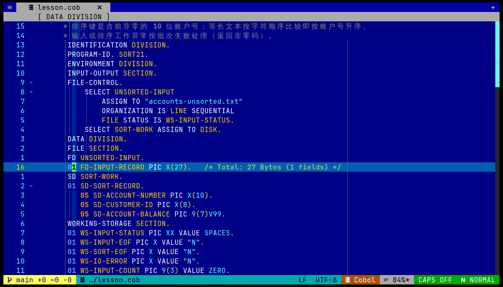
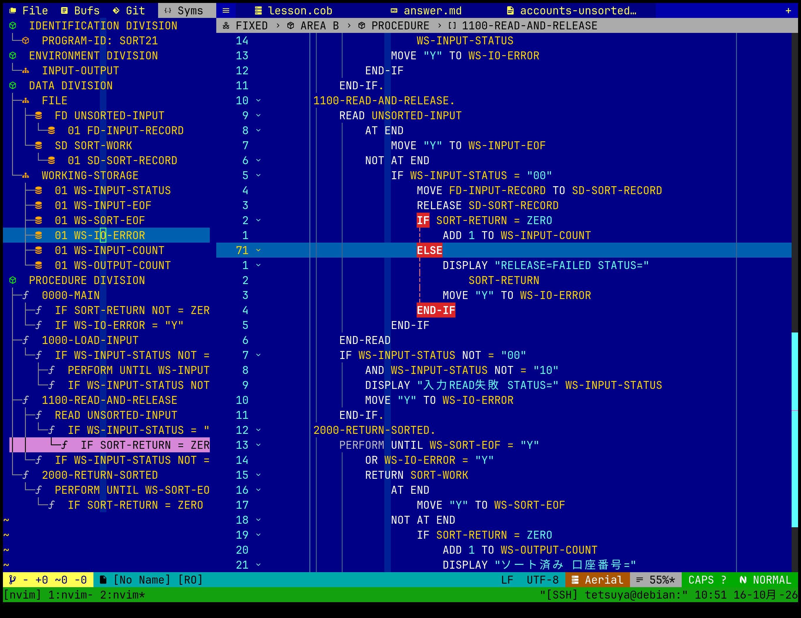

# cobol.nvim

COBOL editing support for Neovim: fixed-format column guides, definition and Copybook navigation, Tree-sitter structure hints, record-size estimation, optional completion, and GnuCOBOL diagnostics. No COBOL language server required.

[简体中文](README.zh-CN.md) · [日本語](README.ja.md) · Neovim help: `:help cobol.nvim`



The screenshot shows the plugin working on a fixed-format program: the column ruler at 7/8/12/73,
the Winbar breadcrumb (`DATA DIVISION`), and the estimated record size on the cursor line.
The theme and layout come from the user's own Neovim configuration.

## What it does

| Area | What you get | Screenshot |
| --- | --- | --- |
| Fixed-format layout | Ruler at columns 7, 8, 12, and 73; column jumps; column-72 overflow highlighting | above |
| IBM z/OS Mainframe Tools | Sequence renumbering (`:CobolRenum`/`:CobolUnnum`), EBCDIC/Nibble/COMP-3 inspector (`:CobolHex`), Smart CAPS (`:CobolCapsToggle`) | [Guide](docs/MAINFRAME_ISPF_GUIDE.md) |
| Structure outline | Multi-level Division / Section / Paragraph / control-flow / data tree in an outline sidebar | [below](#structure-outline-and-scope-hints) |
| Definition and Copybook navigation | `gd`, `gf`, `K` preview, jump-list return | [below](#definition-and-copybook-navigation) |
| Record size calculation | `:CobolCalcRecord` layout table for DISPLAY / COMP / COMP-3 / OCCURS / REDEFINES | [below](#pic-and-record-size-calculation) |
| Diagnostics | Asynchronous `cobc -fsyntax-only` with inline and Quickfix output | [below](#diagnostics) |
| Folding and formatting | Fold by Division / Section / Paragraph / record; format reserved words | [below](#folding-and-formatting) |

## Who is it for?

Beginners learning fixed-format COBOL, developers maintaining `.cob`, `.cbl`, or `.cobol`
programs, and projects that use Copybooks and the traditional Division/Section/Paragraph
structure.

## Requirements

- Neovim 0.10 or newer.
- A C compiler (`gcc`, `clang`, or `cc`) to **build** the bundled Tree-sitter parser. The plugin
  tries to compile a missing parser on startup; AST features need a working parser, but no compiler
  is needed at runtime once `cobol.so` exists.
- Optional: [blink.cmp](https://github.com/saghen/blink.cmp) for completion, GnuCOBOL (`cobc`) for
  diagnostics and build/run, and an outline plugin (Aerial or Syms) for the sidebar tree.

## Installation

With [lazy.nvim](https://github.com/folke/lazy.nvim):

```lua
{
  "iamcheyan/cobol.nvim",
  build = "bash scripts/build_parser.sh", -- optional: pre-build the Tree-sitter parser
  ft = { "cobol", "cbl", "cob" },
  opts = {},
}
```

Without the `build` hook the plugin still tries to compile a missing parser on startup. If no
compiler is available, run `./scripts/build_parser.sh` once one is installed.

For the optional outline sidebar, install Aerial and enable the COBOL backend:

```lua
{
  "stevearc/aerial.nvim",
  opts = function(_, opts)
    opts.backends = vim.tbl_deep_extend("force", opts.backends or {}, {
      cobol = { "cobol" },
    })
  end,
}
```

No outline key is bound by default; map one yourself, for example:

```lua
vim.keymap.set("n", "<leader>cs", "<cmd>AerialToggle<CR>", { desc = "Toggle outline" })
```

The plugin attaches to the `cobol`, `cbl`, and `cob` filetypes. Check `:set filetype?` in an
unrecognized `.cpy` file and set it to `cobol` if needed.

## A first workflow

Save this as a fixed-format `.cob` file — the leading spaces are part of the source format:

```cobol
       IDENTIFICATION DIVISION.
       PROGRAM-ID. DEMO.
       DATA DIVISION.
       WORKING-STORAGE SECTION.
       01 WS-STATUS PIC X VALUE "Y".
       PROCEDURE DIVISION.
           IF WS-STATUS = "Y"
               DISPLAY "READY"
           END-IF.
           STOP RUN.
```

1. Open the file and look at the ruler. `g8` and `g12` jump to Area A and Area B.
2. Put the cursor on `WS-STATUS` and press `gd`; `<C-o>` returns. Press `%` on `IF` or `END-IF` to
   jump to the paired keyword.
3. Run `:CobolCalcRecord` on the `01` item. With `cobc` installed, run `:CobolLint` and then
   `:CobolQuickfix`. `za` folds the current Division, Section, Paragraph, or data item.

## Fixed-format editing

Fixed format reserves columns 1–6 for sequence numbers, column 7 for the indicator area (`*`
comment, `/` page eject, `-` continuation), columns 8–11 for Area A, columns 12–72 for Area B, and
column 73 onward for the identification area. The plugin draws thin guides at columns 7, 8, 12, and
73 and highlights text beyond column 72, where fixed-format compilers ignore source.

| Key | Destination |
| --- | --- |
| `g7` | Indicator column |
| `g8` | Area A |
| `g12` | Area B |
| `g73` | Identification area |

In fixed-format buffers, Insert-mode `<Tab>` stops at columns 7, 8, and 12 when only whitespace
precedes the cursor, then inserts a normal `shiftwidth` indent; `<S-Tab>` reverses through those
stops without deleting source text. Free format has no column stops.

`:CobolGuideToggle` toggles the visual hints and diagnostics attachment;
`:CobolGuideEnable` and `:CobolGuideDisable` reattach or detach them (disabling also clears current
diagnostics). Existing mappings and folding settings stay in place.

`gcc`, Visual `gc`, `<leader>c*`, and `:CobolToggleComment` toggle comments for the detected
source format: `*` in column 7 for fixed format, `*>` for free format. Commands accept a line
range. `:CobolFormatCase` upper-cases recognized reserved words while preserving strings, comments,
and user-defined names; without a range it processes the whole buffer.

## Structure outline and scope hints


The outline sidebar is optional (Aerial or Syms); the plugin ships the COBOL backend for Aerial.
The bundled backend recognizes Divisions, Sections, Paragraphs, program IDs, FD/SD entries, level-01
records, and — when the parser is available — control structures, branches, file operations, calls,
and embedded SQL statements. Without an outline plugin every other feature still works.



The capture above uses Syms as the outline sidebar (Aerial or Syms both work). In the editor the
active `IF ... ELSE ... END-IF` block is marked by colored opening, branch, and closing badges with a
vertical dashed guide line, and the Winbar shows the structure breadcrumb.

With the parser installed, the plugin also marks the **single innermost paired structure** at the
cursor with colored opening and closing badges, a dashed connecting line, and `ELSE` / `WHEN` branch
badges. Supported pairs include `IF`, `EVALUATE`, `PERFORM`, `SEARCH`, `READ`, `WRITE`, `REWRITE`,
`DELETE`, `START`, `STRING`, `UNSTRING`, and the `XML PARSE`, `JSON PARSE`, `EXEC SQL`, `CLASS-ID`,
`METHOD-ID`, `FACTORY`, and `OBJECT` forms.

Configure it with:

```lua
structure_scope = { enable = true, char = "┆", show_branches = true }
```

The Winbar breadcrumb tracks `Division > Section > Paragraph > control structure > WHEN`. The full
chain is available through `:lua require("cobol.ast").show_breadcrumb_float()`. `:CobolStructure`
reports the `END-*` keywords expected at the cursor, innermost first; the floating form is
`:lua require("cobol.ast").show_waiting_closures_float()`. It is not a missing-terminator checker —
unpaired blocks usually do not appear — so use `:CobolLint` for that.

`%` jumps between the start and end keyword of those structures and falls back to Neovim's default
when there is no match. Text objects `af`/`if`, `ae`/`ie`, and `ap`/`ip` select around or inside
`IF`, `EVALUATE`, and `PERFORM` blocks (`vaf`, `daf`, and so on).

## Definition and Copybook navigation


- `gd` / `:CobolGotoDef`: search the current file and recursively referenced Copybooks; choose when
  a name is ambiguous.
- `gf` / `:CobolGotoCopybook`: open the file referenced by the `COPY` statement.
- `K` / `:CobolPreview`: preview the definition or Copybook in a floating window, as shown above.
- `<C-o>` / `<C-i>`: move back and forward through Neovim's jump list.

Paths come from `copybook_paths` or the project profile; no language server is involved. The current
definition index can miss free-format declarations without a fixed-format column prefix, so check
the source format and search paths if a definition is not found.

## PIC and record size calculation


`<leader>cr` or `:CobolCalcRecord` opens a layout table for the current record or field, estimating
sizes for common `DISPLAY`, `COMP`/`BINARY`, `COMP-3`/`PACKED-DECIMAL`, `OCCURS`, and `REDEFINES`
declarations, as shown above.

These values are estimates based on common GnuCOBOL and platform conventions; the compiler remains
the authority for the real ABI and storage layout. In particular, a group-level `OCCURS` is not
multiplied into its subordinate fields, and a larger `REDEFINES` overlay does not increase the
running total, so read the reported length accordingly.

## Diagnostics


The plugin runs:

```text
cobc -fsyntax-only ...
```

Checks run asynchronously after saving, after text changes with a debounce, and when leaving Insert
mode. `<leader>cl` or `:CobolLint` runs one immediately, `<leader>cq` or `:CobolQuickfix` opens the
resulting Quickfix list, and `:CobolDiagnosticsToggle` enables or disables automatic diagnostics.
Unsaved buffer contents are passed to the compiler through standard input when possible. If `cobc`
is missing the plugin does not crash; install GnuCOBOL or set `cobc_command`.

## Folding and formatting


The plugin provides native folding for Divisions, Sections, Paragraphs, and data records: `za`
toggles the current fold, `zc` closes it, and `zo` opens it, as shown above. Control-structure folds
such as `IF`/`EVALUATE` come from other fold providers; when they exist, the parser can render their
summary instead of a raw line count.

`folding.foldtext` decides who owns the fold text:

| Value | Behaviour |
| --- | --- |
| `"auto"` (default) | Install the COBOL summary unless nvim-ufo manages the buffer. |
| `"plugin"` | Always use the COBOL structure summary. |
| `"off"` | Never touch `foldtext`. |

Fixed-format buffers use COBOL-aware indentation for common blocks and data levels; run `gg=G` to
indent the file or `=` over a Visual selection. Sequence/indicator lines, continuation lines,
comments, and nonblank reference-area text at columns 73–80 are preserved.

## Completion

With `blink.cmp` installed, the plugin registers a COBOL completion source for `cobol`, `cbl`, and
`cob` buffers — common verbs and clauses, ready-to-expand snippets such as `IF ... END-IF` and
`PERFORM ... END-PERFORM`, names declared in the buffer, and symbols from referenced Copybooks.
Suggestions are case-insensitive and most useful after a prefix such as `PER`, `WS-`, or `COPY`.
Completion is optional; everything else works without it.

## Project profile

Create `.cobol.json` in the project root:

```json
{
  "source_format": "fixed",
  "dialect": "default",
  "compiler": "cobc",
  "copybook_paths": ["copy", "cpy"],
  "warnings": ["all", "no-obsolete"],
  "compiler_args": ["-Wall"],
  "commands": {
    "build": ["make", "build"],
    "run": ["make", "run"],
    "test": ["make", "test"]
  }
}
```

Project paths resolve from the discovered root, and the same Copybook paths, compiler, format,
dialect, and extra arguments are shared by navigation, completion, diagnostics, and single-file
builds. The profile is optional: without `.cobol.json` the defaults are used silently, while
malformed JSON or invalid fields warn and fall back to safe defaults. Command values are argument
arrays and run without a shell. Without explicit commands the plugin recognizes Makefile
`build`/`all`, `run`, and `test`/`check` targets; a single-source project without a Makefile falls
back to `cobc`. Save the buffer before running project commands.

`:CobolBuild`, `:CobolRun`, and `:CobolTest` run asynchronously and place compiler locations in the
Quickfix list (`:cnext`, `:cprev`).

## Commands

| Command | Purpose |
| --- | --- |
| `:CobolGuideToggle` | Toggle visual hints and diagnostics attachment |
| `:CobolGuideEnable` / `:CobolGuideDisable` | Reattach or detach hints and diagnostics |
| `:CobolToggleComment` | Toggle a comment for the detected source format; accepts a range |
| `:CobolGotoDef` | Jump to a definition |
| `:CobolGotoCopybook` | Open a Copybook |
| `:CobolPreview` | Preview a paragraph or Copybook |
| `:CobolCalcRecord` | Show the record layout estimate |
| `:CobolStructure` | Report the `END-*` keywords expected at the cursor |
| `:CobolFormatCase` | Format recognized reserved words |
| `:CobolLint` | Run the GnuCOBOL syntax check |
| `:CobolQuickfix` | Open the diagnostics Quickfix list |
| `:CobolDiagnosticsToggle` | Toggle automatic diagnostics |
| `:CobolBuild` / `:CobolRun` / `:CobolTest` | Build, run, or check the project |

## Configuration

The defaults suit a small project. A project-specific setup can look like this:

```lua
{
  "iamcheyan/cobol.nvim",
  ft = { "cobol", "cbl", "cob" },
  opts = {
    project_root = vim.fn.expand("~/src/my-cobol-project"),
    copybook_paths = { ".", "./cpy", "./copybooks", "./include" },
    cobc_command = "cobc",
    cobc_extra_args = {},
    source_format = "auto",
    structure_scope = { enable = true, char = "┆", show_branches = true },
    folding = { enable = true, foldtext = "auto" },
    diagnostics = { enable = true, debounce_ms = 600 },
  },
}
```

Other options include `show_hierarchy_hint`, `show_pic_size`, `highlight_levels`, `show_colorcolumn`,
`disable_indent_guide`, `diagnostics.on_save`/`on_change`, `diagnostics.warnings`/`dialect`, and
`completion.enable`. See `:help cobol-configuration` for defaults. The declared `enabled`,
`overflow_col`, and `smart_comments` fields do not currently control their respective behaviour; do
not use them as switches.

## Troubleshooting

- **No column guide or mappings:** check `:set filetype?`, `:verbose nmap gd`, and `keymaps`.
- **No scope badges, breadcrumbs, or `%` matching:** the Tree-sitter parser is missing. Install a C
  compiler or build `cobol.so` with `./scripts/build_parser.sh`.
- **No outline:** the sidebar comes from an optional outline plugin (Aerial or Syms); install and
  configure one.
- **No diagnostics:** check `:echo executable('cobc')` and `cobc_command`.
- **Copybook not found:** set `project_root` and add the directories to `copybook_paths`.
- **Unexpected layout size:** treat calculator output as an estimate and verify with the compiler.

## Development

Run the test suite from the repository root:

```bash
./scripts/test.sh
```

The Aerial-specific test is skipped when Aerial is not installed; the core tests do not require it.

## License

MIT. See [LICENSE](LICENSE).

## Official dropbar integration

`require('cobol.dropbar')` is an optional source for the official
[Bekaboo/dropbar.nvim](https://github.com/Bekaboo/dropbar.nvim). Add it to
`bar.sources` to use native dropbar hierarchy menus without contextline or a fork.
Set `show_winbar = false` in cobol.nvim so dropbar owns the winbar. The source preserves the bracketed AST chain and right-aligned waiting closures.
